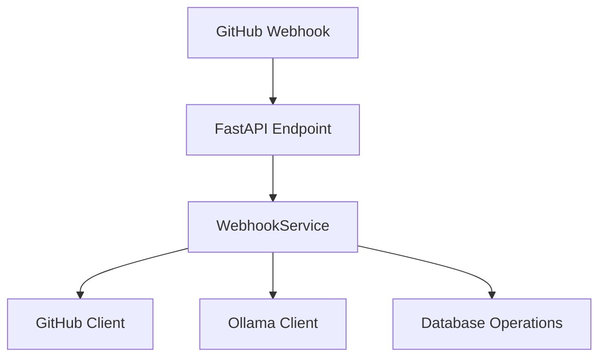
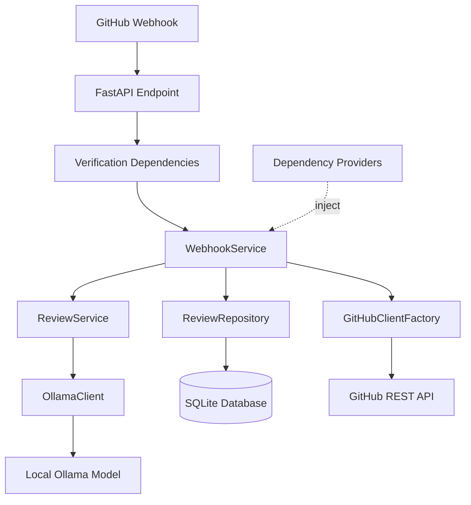

# ♟️ Checkmate — Refactoring Update

> **Scope:** Implementation of manager feedback on Dependency Injection, service architecture, structured models, and database integration. This is a temporary update, not the final README.

## 1. What Needed Improvement?

| Previous Implementation | Improvement Required |
|---|---|
| Services instantiated dependencies internally | Dependency Injection |
| Webhook service handled tightly coupled operations | Separation of responsibilities |
| Review logic directly coupled to Ollama | Dedicated ReviewService |
| Unstructured dictionaries used across workflows | Typed models and Pydantic validation |
| Database operations coupled to application logic | Repository pattern |

## 2. Updated System Architecture

### Before

Services were more tightly coupled, with dependencies and responsibilities mixed within the workflow.

### After — Dependency Injection & Separation of Responsibilities

**Key change:** Dependencies are now injected into services instead of being instantiated within business logic. The `WebhookService` orchestrates the workflow, while GitHub communication, AI review, and persistence are handled by dedicated components.

## 3. What Was Implemented?

| Component | Implementation |
|---|---|
| **Dependency Injection** | Centralized providers in `app/dependencies/services.py` |
| **WebhookService** | Injects `ReviewRepository`, `GitHubClientFactory`, and `ReviewService` |
| **ReviewService** | Dedicated review-processing service with injected `OllamaClient` |
| **Pydantic Models** | Structured and validated webhook, response, and review models |
| **Type Safety** | Typed internal workflow data and restricted status/severity values |
| **Repository Pattern** | Isolated database operations, persistence, and transaction handling |

## 4. Verification

| Check | Result |
|---|---|
| Compilation | Passed |
| Automated tests | **18/18 passed** |
| Database persistence tests | Passed |
| Duplicate webhook handling | Passed |
| Transaction rollback | Passed |
| `git diff --check` | Passed |

## Outcome

The refactoring addresses the manager's feedback by introducing a cleaner dependency-injected architecture, separating service responsibilities, enforcing structured data models, and isolating database operations.

**Implementation complete and verified.**

*Temporary refactoring documentation — to be replaced by the final README.*
